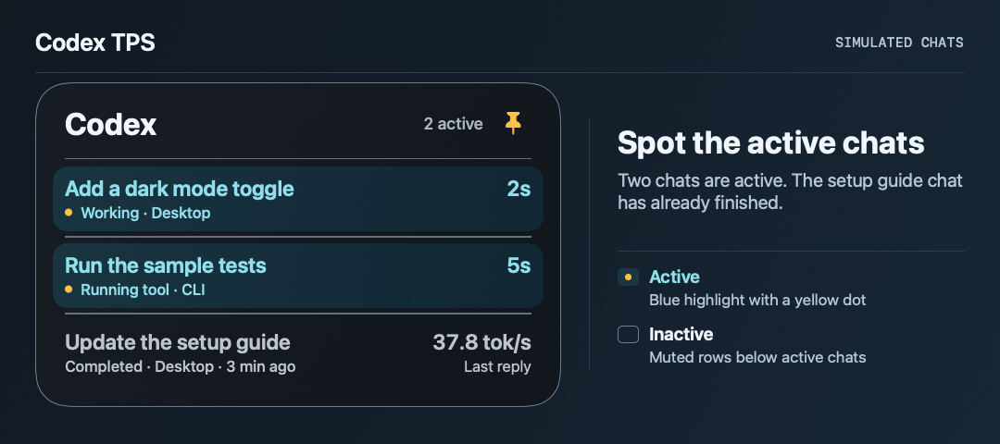

# Codex TPS

A small Mac desktop card that shows which Codex chats are active and how fast Codex is replying.

**[Download the DMG](https://github.com/jiediking/codex-tps-app/releases/latest/download/Codex-TPS-macOS-universal.dmg)** · macOS 14+ · Apple silicon and Intel

## Install or update

Paste this command into Terminal for a first install or an update.

```sh
/bin/bash -ec 'script=$(/usr/bin/curl -fsSL --proto "=https" --proto-redir "=https" https://github.com/jiediking/codex-tps-app/releases/latest/download/install.sh); /bin/bash -c "$script"'
```

**Updating from Terminal?** You can run the same command while TPS is open. The installer automatically quits, updates, and reopens TPS. Codex Desktop can stay open during the update.

**Using the DMG?** Quit TPS before replacing an existing copy. Open the DMG and drag **Codex TPS** into **Applications**.

macOS may show a warning on first open. The app is signed locally and has not been notarized. [Apple’s first-open instructions](https://support.apple.com/102445)

## Connect to Codex

1. Open **Codex TPS** from **Applications** if it’s closed.
2. Open **Codex Desktop** if it’s closed.
3. Click the TPS icon in the menu bar and check **Connections → Codex Desktop**. When it shows **Connected**, send a message in Codex to see live activity on the card.

If that row shows **Restart Codex**, quit and reopen Codex Desktop to resume live updates.

**Using Codex in Terminal?** With TPS open, run `codex` in Terminal and start a chat.

## Read the card

- A **yellow dot and highlight** mark an active chat. Recent finished chats appear below the active ones.
- **`≈ 56 tok/s`** means about 56 tokens per second for the reply in progress.
- **Last reply** shows the finished reply’s speed when available.



*Simulated chats and speeds.*

## Quit or uninstall

Choose **Quit** from the TPS menu. Codex can keep running. To uninstall, move TPS to the Trash after quitting. Your Codex chats and settings stay in place.

<details>
<summary>Connections, privacy, and card settings</summary>

- **Waiting for Codex** means TPS is ready for the next Desktop launch. Keep TPS open and it reconnects the next time you open Codex.
- TPS processes local chat titles, activity, and usage on your Mac. Quitting TPS removes its temporary Desktop launch setting. Any relay still in use cleans up when the current Codex session ends.
- The pin keeps the card on top. The TPS menu lets you show average speed, cache hit rate, and context usage. A normal TPS quit resets its card preferences.

</details>

<details>
<summary>Install from files you already downloaded</summary>

Download the DMG, `install.sh`, and `SHA256SUMS.txt` from the [same release](https://github.com/jiediking/codex-tps-app/releases/latest). In the folder containing all three, run:

```sh
shasum -a 256 -c SHA256SUMS.txt && \
  bash install.sh --dmg Codex-TPS-macOS-universal.dmg
```

The installer puts TPS in `/Applications`. Use `--install-dir` to choose another existing folder.

</details>

<details>
<summary>Build and test from source</summary>

Use Xcode 27.

```sh
xcodebuild -project 'Codex TPS.xcodeproj' -scheme 'Codex TPS' -configuration Release \
  -destination 'generic/platform=macOS' -derivedDataPath .build/xcode build

xcodebuild -project 'Codex TPS.xcodeproj' -scheme 'Codex TPS' \
  -destination 'platform=macOS' -parallel-testing-enabled NO -derivedDataPath .build/xcode test

bash scripts/package-macos.sh '.build/xcode/Build/Products/Release/Codex TPS.app' \
  .build/release jiediking/codex-tps-app
```

[Build workflow](.github/workflows/build.yml) · [Release workflow](.github/workflows/release.yml)

</details>

An independent companion for Codex. Speed and usage metrics inspired by [llm-vitals](https://github.com/tecyfyai/llm-vitals). [MIT License](LICENSE).
